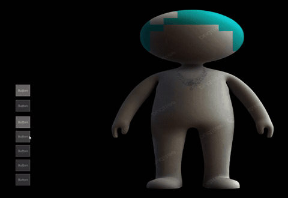

<style>
  body {
    background-color: #2e1753;
    color: #e3d1e7;
  }
  div.highlighter-rouge,
  div.highlighter-rouge .highlight,
  div.highlighter-rouge pre {
    background-color: #000;
    color: #ececec;
  }
  div.highlighter-rouge pre {
    padding: 1em;
    border-radius: 8px;
    overflow-x: auto;
  }
  div.highlighter-rouge code {
    background: transparent;
    color: inherit;
  }
</style>

# Multimedial




---

### Índice

## Unidad I. 
1. [Código base](#1-primera-página)
2. [Enlaces](#2-enlaces-y-navegación)
3. [Mini sitio de 3 páginas](#3-mini-sitio-de-3-páginas)
4. [Mi portafolio web](#4-mi-portafolio-web)
5. [Sitio web directo](https://mimii-07.github.io/Multimedial/w/index.html)

## Unidad II. [Programación visual creativa](#unidad-ii-programación-visual-creativa)
1. [Ejercicios y proyecto](#ejercicios-y-proyectos)

---

## Unidad I. Hipervínculo y Desarrollo Web

### 1. Código


```html
<!DOCTYPE html>
<!-- Indica al navegador que este documento usa HTML5 -->

<html>
<!-- Inicio del documento HTML -->

<head>
<!-- Sección donde van metadatos, título y estilos -->

<meta charset="UTF-8">
<!-- Define la codificación de caracteres para que se vean bien tildes y símbolos -->

<title>Multimedial</title>
<!-- Título de la página que aparece en la pestaña del navegador -->

<style>
/* Aquí comienza la sección de estilos CSS que define la apariencia visual */

body {
/* "body" se refiere a todo el contenido visible de la página */

  background-color: white;
  /* Define que el fondo de toda la página sea blanco */

  color: black;
  /* Define que el color del texto sea negro */

  margin: 0;
  /* Elimina los márgenes que los navegadores agregan por defecto */

  height: 100vh;
  /* Hace que el alto del cuerpo sea igual al 100% de la altura de la pantalla */

  display: flex;
  /* Activa el sistema Flexbox para organizar y centrar elementos */

  justify-content: center;
  /* Centra el contenido horizontalmente */

  align-items: center;
  /* Centra el contenido verticalmente */

  font-family: Arial, sans-serif;
  /* Define la tipografía del texto */

  font-size: 60px;
  /* Define el tamaño grande del texto */
}
/* Fin de las reglas de estilo del body */

</style>
<!-- Fin de la sección de estilos -->

</head>
<!-- Fin de la sección head -->

<body>
<!-- Inicio del contenido visible de la página -->

MULTIMEDIAL
<!-- Texto que aparece en el centro de la pantalla -->

</body>
<!-- Fin del contenido visible -->

</html>
<!-- Fin del documento HTML -->
```

---

### 2. Enlaces
Aquí se puede ver como las paginas se entrelazan entre sí, redirigiendo de una página a otra. Además que se puede evidenciar la interaccion del cursor sobre los botones haciendo que cambien su tamaño y color.

<video src="https://raw.githubusercontent.com/mimii-07/Multimedial/main/img/enlaces.mp4" controls width="800"></video>

```html
<!-- Enlace interno hacia otra página dentro de la misma carpeta -->
<a href="obras.html">Obras</a>

<!-- Enlace externo que se abre en una pestaña nueva -->
<a href="[https://mimii-07.github.io/Multimedial/w/index.html](https://mimii-07.github.io/Multimedial/w/index.html)" target="_blank">Ver portafolio</a>
```


---

### 3. Mini sitio de 3 páginas
Podemos ver como la página consite de 3 minisitios generales el cual es el index o portada, obras y finalmente la pagina de contacto.

<video src="https://raw.githubusercontent.com/mimii-07/Multimedial/main/img/paginas.mp4" controls width="800"></video>

#### Código base de la portada (`w/index.html`):
```html
<!DOCTYPE html>
<html lang="es">
<head>
    <meta charset="UTF-8">
    <title>Michelle Velásquez Sáez</title>

    <!-- Vincula el documento HTML con una hoja de estilos CSS externa -->
    <link rel="stylesheet" href="style.css">
</head>

<body>

    <!-- Contenedor general que agrupa la tarjeta de presentación y el menú -->
    <div>

        <!-- Bloque de identidad: imagen, nombre y disciplina -->
        <div>
            
            <!-- src indica la ruta dentro de la carpeta img/ y alt describe la imagen -->

            <h2>Michelle Velásquez Sáez</h2>
            <!-- Encabezado de nivel 2 para el nombre principal -->

            <p>Artista Visual</p>
            <!-- Párrafo descriptivo -->
        </div>

        <!-- Bloque de navegación hacia las demás secciones del sitio -->
        <div>
            <a href="obras.html">Obras</a>
            <a href="contacto.html">Contacto</a>
        </div>

    </div>

</body>
</html>
```
1. `index.html`: Portada principal con presentación e imagen de perfil.
2. `obras.html`: Sección dedicada al registro visual y descripción de obras.
3. `contacto.html`: Página con datos de contacto y enlaces de retorno.

---

### 4. Mi portafolio web
Finalmente el mayor contenido de la pagina son mis obras, las cuales tienen todas sus paginas independientes y cada una tiene la opcion de volver al inicio, ver el catalogo de todas las obras o ir al contacto. Todos los botones reaccionar con la interaccion del cursor.

<video src="https://raw.githubusercontent.com/mimii-07/Multimedial/main/img/Grabaci%C3%B3n%202026-11-17%20130052.mp4" controls width="800"></video>


> **Sitio publicado:** [https://mimii-07.github.io/Multimedial/w/index.html](https://mimii-07.github.io/Multimedial/w/index.html)

---

## <span style="color:;">Unidad II. Programación visual creativa</span>

### Ejercicios y proyectos
Registro de ejercicios de Touchdesigner y generacion de imagenes con IA:

1. [Chroma](https://drive.google.com/file/d/1FoSuo0MsIiyIaFPuccK0SWyaMMAqe5me/view?usp=drive_link)
2. [Lsystem](https://drive.google.com/file/d/1SQJT6WJU7a_okktyoo1sFnawrnpI_QqD/view?usp=drive_link)
3. [Point](https://drive.google.com/drive/folders/17M0PenrL7a8SVX96ALYR3-NVj5Ro60AU?usp=drive_link)
4. [Comfy](https://drive.google.com/drive/folders/1fxfipq6L57-wN_1qWwnH6ICLYTfczmQC?usp=drive_link) 
5. [Proyecto personal](https://drive.google.com/file/d/1FSXz_iKuLHTPLSfBmPNvoSj7b77pBnDH/view?usp=drive_link) 